<div align="center">

# 📊 Лабораторная работа № 2

### Снижение размерности и кластеризация данных · Вариант 18

**Python · NumPy · pandas · Matplotlib · scikit-learn · SciPy**

[](https://www.python.org/)
[](https://scikit-learn.org/)
[](#-результаты)

**[Код анализа](lab2.py) · [Код кластеризации](clustering_lab2.py) · [Графики](graphs/)**

</div>

---

## 🎯 Цель работы

Исследовать методы снижения размерности и кластеризации многомерных данных, сравнить полученные результаты, визуализировать структуру выборок и определить наиболее подходящий алгоритм кластеризации для **варианта 18**.

**Задачи:**

1. Построить матрицу корреляций и матрицу разброса исходных признаков.
2. Применить анализ главных компонент **PCA (Principal Component Analysis)**, сингулярное разложение **SVD (Singular Value Decomposition)** и анализ независимых компонент **ICA (Independent Component Analysis)**.
3. Оценить значимость компонент и построить двумерные проекции с направлениями исходных признаков.
4. Сравнить **12 алгоритмов кластеризации** на одной выборке.
5. Исследовать выбросы, подобрать параметры и сопоставить результаты с эталонными классами.

## 🗂️ Структура проекта

```text
Lab2-Data-Analysis/
├── lab2.py                         # Часть 1: PCA, SVD, ICA
├── clustering_lab2.py              # Часть 2: 12 алгоритмов кластеризации
├── Lab2_Dataset_PCA.xlsx           # Исходные данные для части 1
├── Lab2_Dataset_Clustering.xlsx    # Исходные данные для части 2
├── graphs/                         # Графики PNG и таблица метрик CSV
└── README.md
```

> Названия файлов показаны в соответствии с используемыми скриптами. Отчёт в формате Word можно хранить в корне репозитория отдельным файлом.

## 🧪 Часть 1. Снижение размерности

Исследованы **222 объекта** с пятью признаками. Для анализа применены PCA, SVD и ICA. Наибольшая попарная корреляция наблюдается между признаками `c` и `e` (около 0,237). Первые две компоненты PCA сохраняют 47,08 % дисперсии, а первые четыре — 85,21 %.

## 🧩 Часть 2. Кластеризация

Проанализированы **226 объектов** с двумя признаками и тремя эталонными классами. Сравнены 12 алгоритмов. Лучшее совпадение с эталоном среди проверенных настроек показала **Gaussian Mixture** (ARI = 0,509).

| Алгоритм | Кластеров | Шум | ARI | NMI |
|---|---:|---:|---:|---:|
| **Gaussian Mixture** | 3 | 0 | **0,509** | **0,487** |
| Ward | 3 | 0 | 0,357 | 0,422 |
| Bisecting K-Means | 3 | 0 | 0,328 | 0,342 |
| Spectral Clustering | 3 | 0 | 0,320 | 0,374 |
| Birch | 3 | 0 | 0,320 | 0,366 |
| K-Means | 3 | 0 | 0,245 | 0,273 |
| Agglomerative | 3 | 0 | 0,223 | 0,290 |
| HDBSCAN | 2 | 86 | 0,215 | 0,232 |
| Affinity Propagation | 16 | 0 | 0,154 | 0,365 |
| OPTICS | 5 | 149 | 0,067 | 0,242 |
| Mean Shift | 1 | 0 | 0,000 | 0,000 |
| DBSCAN | 2 | 6 | −0,001 | 0,022 |

## 🖼️ Галерея результатов

Все изображения представлены прямо на странице. Нажми на изображение, чтобы открыть его в полном размере.

### Рисунок 1. Матрица корреляций

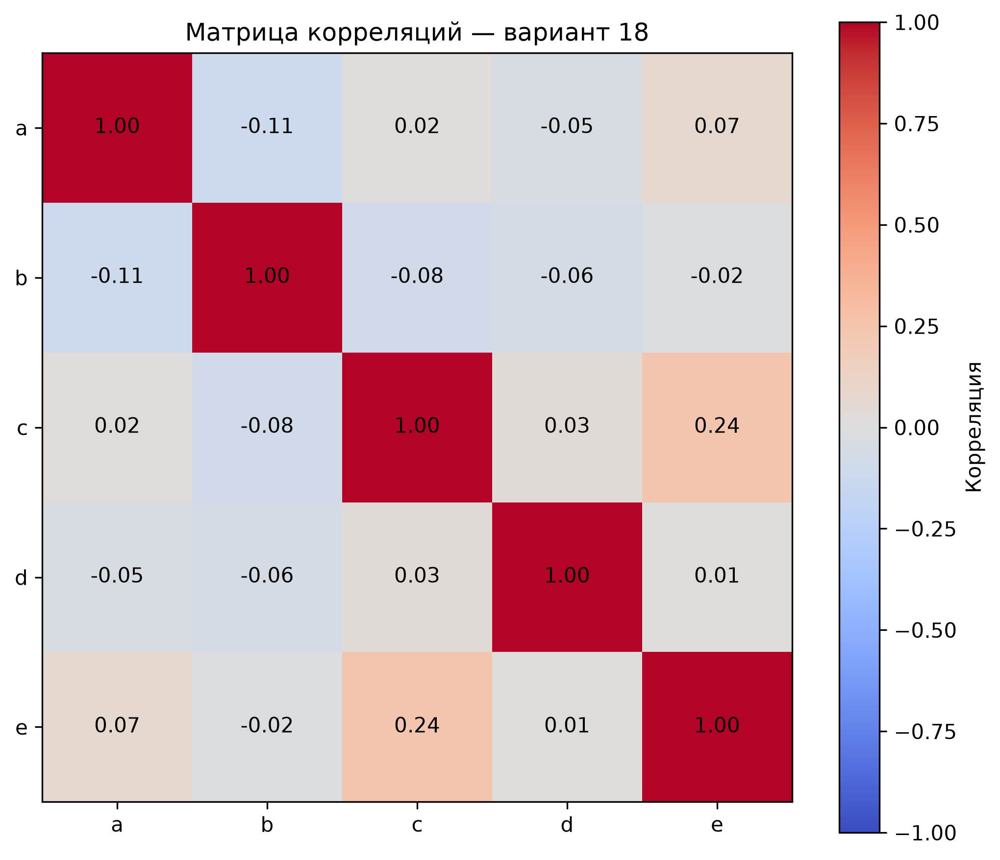

*Коэффициенты линейной связи между пятью признаками.*

### Рисунок 2. Матрица разброса

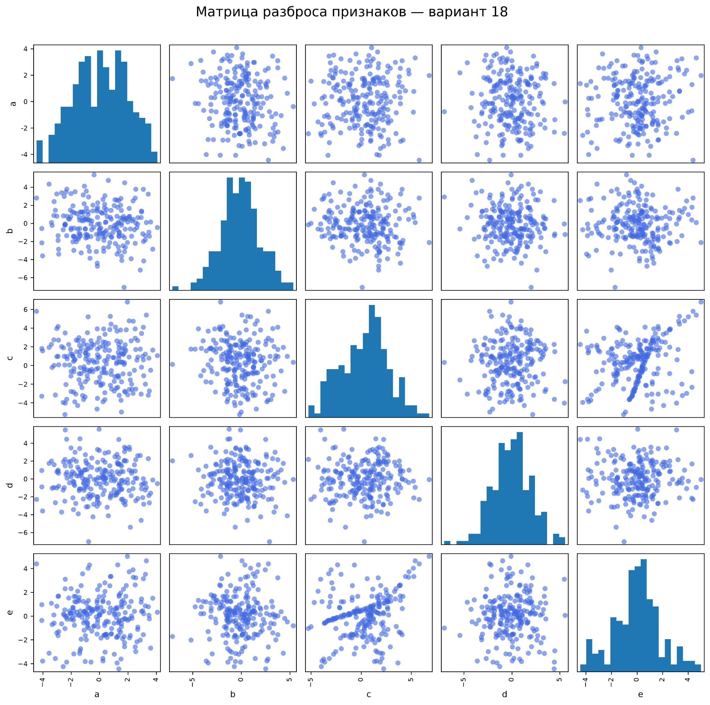

*Распределения признаков и попарные зависимости.*

### Рисунок 3. Значимость компонент PCA

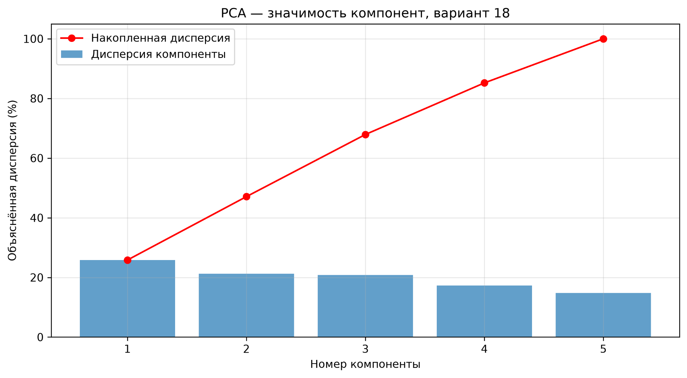

*Доля объяснённой и накопленной дисперсии.*

### Рисунок 4. Значимость компонент SVD

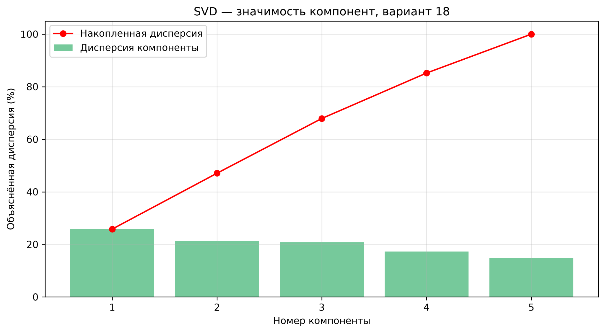

*Результаты сингулярного разложения.*

### Рисунок 5. Ошибка восстановления ICA

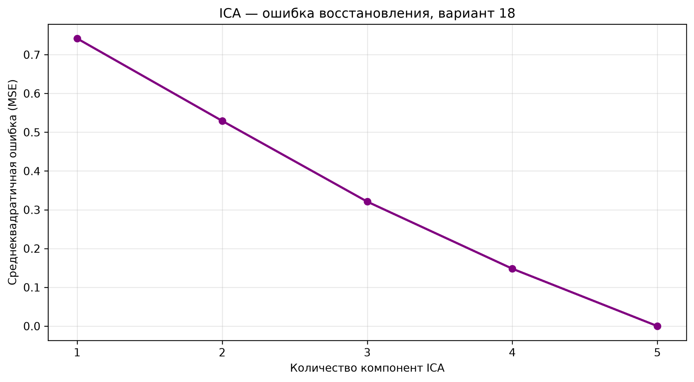

*Зависимость ошибки от числа компонент.*

### Рисунок 6. Сравнение PCA, SVD и ICA

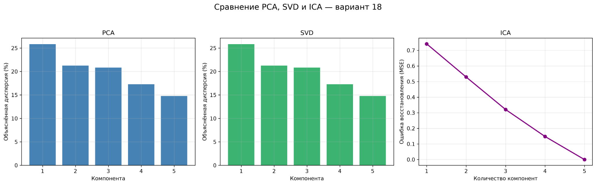

*Сопоставление методов снижения размерности.*

### Рисунок 7. Двумерные проекции

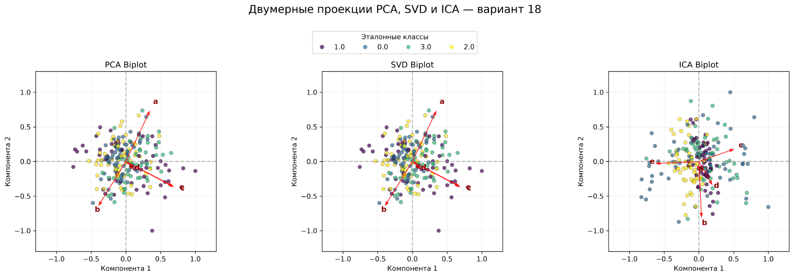

*Расположение объектов и направления исходных признаков.*

### Рисунок 8. Исходные данные и эталон

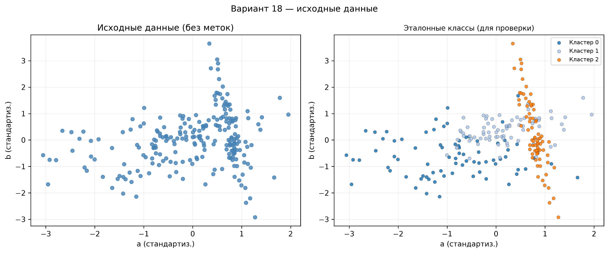

*Распределение объектов до кластеризации и по истинным меткам.*

### Рисунок 9. Сравнение 12 алгоритмов

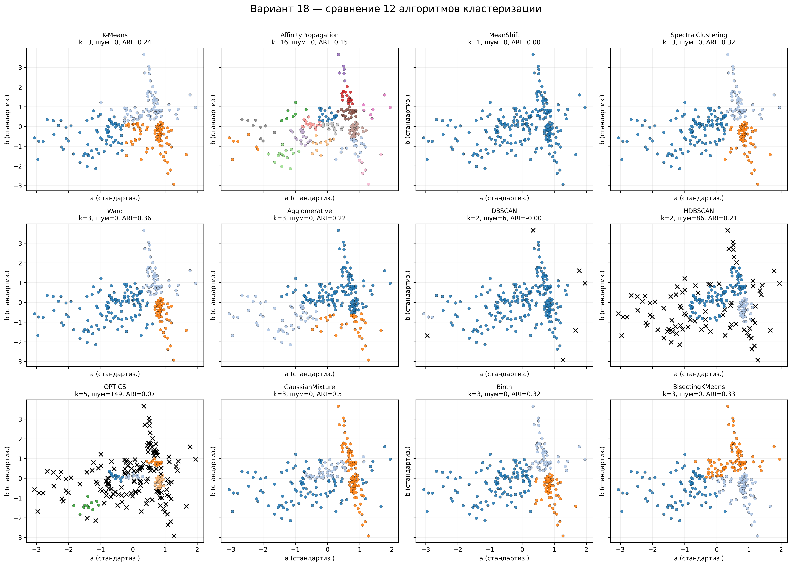

*Разбиение объектов разными алгоритмами.*

### Рисунок 10. Метод локтя

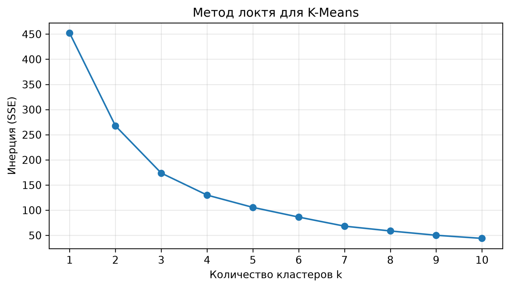

*Инерция K-Means при разных значениях k.*

### Рисунок 11. Силуэтный анализ

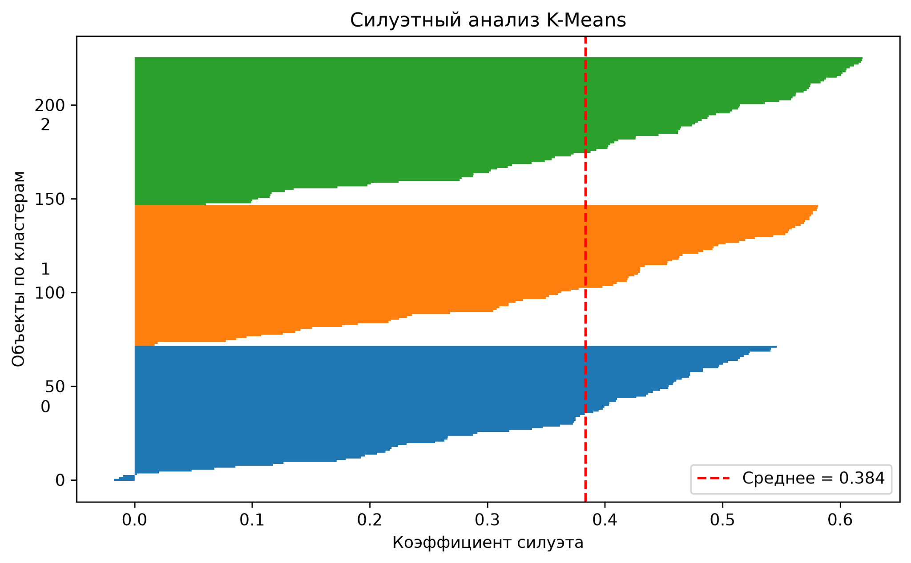

*Качество разделения кластеров K-Means.*

### Рисунок 12. Дендрограмма Ward

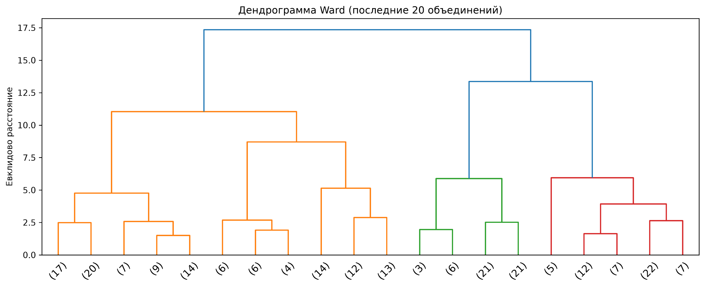

*Иерархия объединения кластеров.*

### Рисунок 13. Выбросы и шум

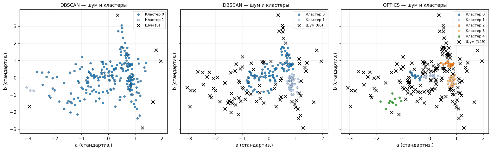

*Объекты, выделенные DBSCAN, HDBSCAN и OPTICS как шум.*

[Скачать таблицу метрик (CSV)](graphs/2_5_clustering_metrics.csv)

## 🚀 Запуск проекта

**Требования:** Python 3.11+ и библиотеки `numpy`, `pandas`, `matplotlib`, `scikit-learn`, `scipy`, `openpyxl`.

```bash
# Клонирование репозитория
git clone https://github.com/podshivalinrodion/Lab2-Data-Analysis.git
cd Lab2-Data-Analysis

# Установка зависимостей
python -m pip install numpy pandas matplotlib scikit-learn scipy openpyxl

# Часть 1: снижение размерности
python lab2.py

# Часть 2: кластеризация
python clustering_lab2.py
```

Результаты выводятся в консоль; изображения сохраняются в папку **`graphs/`** в формате **PNG, 300 DPI**. Скрипты используют Excel-файлы, расположенные рядом с ними.

## ✅ Итоги

- Исследованы корреляции и двумерные зависимости пяти исходных признаков.
- Сопоставлены PCA, SVD и ICA; для сохранения более 80 % дисперсии потребовались четыре компоненты.
- Реализованы и визуально сравнены 12 алгоритмов кластеризации.
- Проанализированы выбросы и качество разбиения с помощью внутренних и внешних метрик.
- **Gaussian Mixture показал наибольшее соответствие эталонной разметке** среди проверенных настроек алгоритмов.

---

<div align="center">

**Лабораторная работа № 2 · Вариант 18**  
Автор: [podshivalinrodion](https://github.com/podshivalinrodion)

</div>
